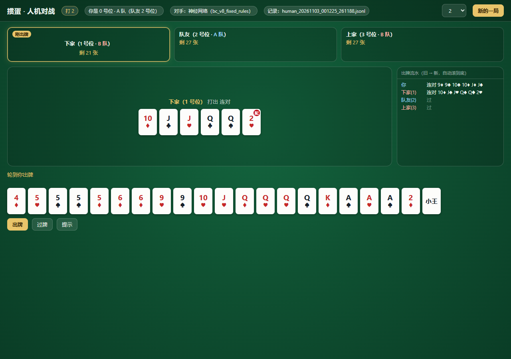
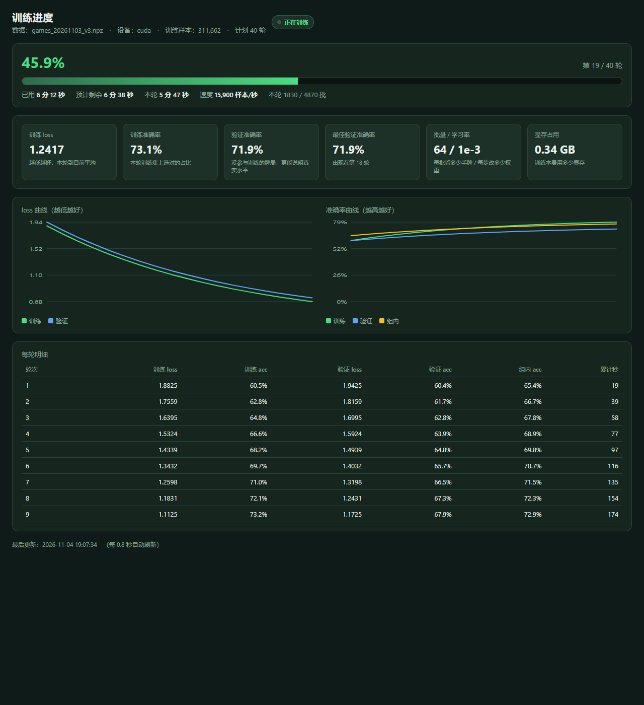

<div align="center">

# 掼蛋 AI 实验室 · GuanDan AI Lab

**一个可复现的掼蛋（Guandan）研究平台：规则引擎、策略基线、数据管线、神经网络与本地对战界面。**


</div>

掼蛋是四人两副牌的组队扑克游戏，属于**不完全信息博弈**：你只看得见自己的 27 张牌，另外三家的牌和队友的意图都只能靠推理。

本项目把掼蛋做成一个**能验证、能测量、能复现**的研究环境：规则有测试兜底，策略有统一评估口径，数据管线会逐条回放校验，性能数字都附测量命令。研究方向是不完全信息博弈下的强化学习（参考 SDMC 思路），掼蛋只是基准环境。

> **诚实边界（重要）**
> 当前实现到**行为克隆**为止——它在模仿启发式老师，理论上限就是老师本身，**不是强化学习产物**。
> 本项目**没有复现**参考论文，也**没有达到**论文水平。路线详情见 [docs/STATUS.md](docs/STATUS.md)。



## 目录

- [特性](#特性)
- [快速开始](#快速开始)
- [实测结果](#实测结果)
- [项目结构](#项目结构)
- [文档](#文档)
- [路线图](#路线图)
- [已知局限](#已知局限)
- [参与开发](#参与开发)
- [许可证](#许可证)

## 特性

**规则引擎**（`game_engine/`）
两副牌 108 张、四人各 27 张；2 最小、级牌上浮、红桃级牌为逢人配（万能牌）；9 种牌型、炸弹阶梯、牌权与名次判定。规则以负责人确认表为唯一依据，不使用「常见规则」默认值，见 [docs/RULES.md](docs/RULES.md)。

**策略基线**（`players/`）
随机策略、启发式策略（手牌成本估计 + 控场判断）、神经网络策略（候选打分，CUDA 推理）。

**数据管线**（`training/`）
采集 → 结构校验 → 导出 npz（整局重放 + 逐条一致性校验）；支持多进程并行导出（6.2×）。

**训练与评估**（`training/`）
行为克隆、价值网络、自我对弈采样；统一成对评估（同种子换座位 + Wilson 置信区间）；训练进度网页。

**对战界面**（`interface/`）
本地网页版，纯标准库、无框架、无 CDN；同点数手牌叠放、出牌流水、逢人配标记、对局自动落盘；提供**免安装 exe**。

**性能基准**（`tools/benchmark.py`）
统一入口，quick / standard / full 三档预设，报告格式固定，可与历史基线逐项对比。

## 快速开始

### 方式一：下载即玩（Windows，无需 Python）

到 [Releases](https://github.com/gyk0627/Guandan-AI-Lab/releases) 下载 `GuandanAI-win64.zip`，解压后双击 `GuandanAI.exe`：会弹出一个**真正的窗口**（有自己的标题栏，没有地址栏和标签页），关掉窗口程序就退出。

窗口是进程内嵌的 WebView2 控件（Win11 自带；Win10 一般随 Edge 装好），不是外部浏览器——所以即使 Windows 账户是管理员权限也不会白屏。万一系统缺 WebView2，程序会提示一句并自动改用默认浏览器打开。包里是启发式 AI。

对局记录默认只存本地 `replay/`。想收集别人的对局，选一种打包方式：

**模式 A：一键发到作者邮箱（推荐，朋友只需点一下按钮）**

```powershell
& .\.venv\Scripts\python.exe -X utf8 -m tools.package_exe `
    --email 你的邮箱@example.com `
    --smtp-host smtp.qq.com --smtp-user 你的邮箱@example.com --smtp-password 授权码
```

发布包里会写入 `mail.json`。朋友解压双击就能玩，**每局打完会弹出一个结束面板**，
中间一个大按钮「发送这一局给作者」：点一下，记录打包成 zip 直接发到你的邮箱，页面回一句
「谢谢你」并自动开始下一局——不用改文件、不用装邮件客户端。不想发也行，下面有一行小字
「不想发，直接开下一局」。
网络不通时按钮不会硬失败，会把 zip 存到「下载」并显示完整路径，朋友把文件发给你也行。

> ⚠️ `mail.json` 里的 SMTP 密码跟着包一起分发，拿到包的人能解出来。
> 请用**专用邮箱 + 授权码**（QQ/163 邮箱在设置里开 SMTP 后生成），不要用个人主邮箱的登录密码。

**模式 B：包里配好回传地址（自己开接收端，朋友零操作）**

```powershell
& .\.venv\Scripts\python.exe -X utf8 -m tools.package_exe `
    --upload-url http://你的电脑IP:8790/upload --token guandan-local
```

朋友解压、双击就能玩，每局打完自动传回；传不上去会先存本地，下次启动接着传，
不用教他改任何文件。

**模式 C：什么都不配（朋友点「导出对局」发文件）**

```powershell
& .\.venv\Scripts\python.exe -X utf8 -m tools.package_exe
```

发布包里只有 `upload.json.example`。朋友打完（打一半也行）点窗口右上角「导出对局」，
文件会存到他的「下载」文件夹（文件名以 `human_` 开头），让他把这个文件发给你。

**接收方先开接收端**：双击仓库根目录的 `start_collector.bat`（监听 8790、口令 `guandan-local`、
文件存 `collected\`），窗口别关；也可以手动跑
`python -m tools.collect_server --dir collected --port 8790 --token guandan-local`。
完整步骤和 `upload.json` 格式见 [docs/USAGE.md](docs/USAGE.md#免安装-exe)。

### 方式二：从源码运行

```powershell
git clone https://github.com/gyk0627/Guandan-AI-Lab.git
cd Guandan-AI-Lab
python -m venv .venv
& .\.venv\Scripts\python.exe -m pip install -r requirements.txt

# 跑测试（约 30 秒）
& .\.venv\Scripts\python.exe -X utf8 -m pytest tests -q

# 打一局（浏览器打开 http://127.0.0.1:8765/）
& .\.venv\Scripts\python.exe -X utf8 -m interface.web_server --level 2
```

> `torch` 只有训练和神经网络对战才需要；不装也能跑规则引擎、数据管线、对战界面（自动退回启发式）。
> CUDA 用户请用 cu128 索引安装，命令见 `requirements.txt` 注释。

更多命令（采集、导出、训练、评估、基准）见 [docs/USAGE.md](docs/USAGE.md)。



## 实测结果

所有数字都可用仓库内命令复现，测量条件写在括号里，详细记录见 [docs/EXPERIMENTS.md](docs/EXPERIMENTS.md)。

| 指标 | 数值 | 条件 |
|---|---|---|
| 测试用例 | **450 通过** | `pytest tests -q`，约 30 秒 |
| 行为克隆验证一致率 | **0.7500** | 5000 局 / 478,895 决策，40 轮，batch 64 |
| 神经网络 vs 启发式老师 | **53.00%** | 200 局（100 对）成对换座，`--level 2`，95% CI 46.09–59.80 |
| 神经网络 vs 随机 | **93.00%** | 400 局，95% CI 90.07–95.11 |
| 启发式 vs 随机 | 88.00% | 200 局，95% CI 82.77–91.80 |
| 价值网络 AUC | 0.6997 | 258 维状态编码 |
| CPU 模拟吞吐 | 约 4.7 局/秒 | 单进程，启发式自我对弈 |
| GPU 推理吞吐 | 33.7 万次/秒 | batch 128，RTX 5060 Laptop |
| 并行导出加速 | **6.2×** | 5000 局，8 分片 vs 单进程 |
| 训练显存峰值 | 0.34 GB | PyTorch 计时口径，不含桌面占用 |

**一致率随候选数量骤降**（自由领出是短板）：候选 2 个 0.993、3–5 个 0.844、6–20 个 0.708、21–100 个 0.544、101+ 个 0.385。这也是当前最值得改的地方。

## 项目结构

```text
GuanDan-AI-Lab/
├─ game_engine/          规则引擎（牌力、牌型、比较、合法动作、对局状态、逢人配）
├─ players/              策略：启发式 / 神经网络 / 采样 / 前瞻
├─ training/             编码器、数据采集与导出、Dataset、模型、训练脚本
├─ evaluation/           成对评估、基准报告
├─ interface/            本地网页对战、训练进度网页、exe 启动器
├─ tools/                统一基准入口、并行导出、打包、性能采样
├─ tests/                450 个测试用例
├─ docs/                 规则、架构、数据格式、实验记录、测试说明
├─ models/               训练产物（.pt + 指标 JSON）
└─ replay/               对局日志
```

## 文档

| 想知道什么 | 看哪里 |
|---|---|
| 规则怎么定的、依据是什么 | [docs/RULES.md](docs/RULES.md) |
| 常用命令、怎么训练/评估/测速 | [docs/USAGE.md](docs/USAGE.md) |
| 做到哪了、还有什么没做 | [docs/STATUS.md](docs/STATUS.md) |
| 实验编号、参数、数字、负结果 | [docs/EXPERIMENTS.md](docs/EXPERIMENTS.md) |
| 模块职责与数据流 | [docs/ARCHITECTURE.md](docs/ARCHITECTURE.md) |
| 数据集与 npz 字段 | [docs/DATA_FORMAT.md](docs/DATA_FORMAT.md) |
| 测试组织方式 | [docs/TESTING.md](docs/TESTING.md) |
| 术语对照 | [docs/GLOSSARY.md](docs/GLOSSARY.md) |
| 硬件选型与租用方案 | [docs/HARDWARE.md](docs/HARDWARE.md)、[docs/RENT_PLAN.md](docs/RENT_PLAN.md) |
| 论文初稿与数字来源 | [docs/paper/draft.md](docs/paper/draft.md)、[docs/paper/NUMBERS.md](docs/paper/NUMBERS.md) |
| 改动历史 | [CHANGELOG.md](CHANGELOG.md) |

## 路线图

| 阶段 | 内容 | 状态 |
|---|---|---|
| 1 | 规则引擎与基础对局 | ✅ 完成 |
| 2 | 随机与启发式策略 | ✅ 完成 |
| 3 | 数据采集、校验与导出 | ✅ 完成 |
| 4 | 人类高手对局数据 | ⬜ 未开始（缺数据来源） |
| 5 | 神经网络训练（行为克隆） | ✅ 追平启发式老师 |
| 6 | 强化学习（自我对弈 + SDMC 方向） | ⬜ 未开始，入口条件已具备 |
| 7 | 大规模训练与模型联赛 | ⬜ 未开始（需服务器） |
| 8 | 本地部署 | 🟠 网页版 + exe 已可用 |

## 已知局限

- **不是强化学习**：只有行为克隆，理论上限等于老师；所有增强尝试（一步前瞻、成对奖励、软标签、置换等价损失）在实验中均为负结果，记录在 [docs/EXPERIMENTS.md](docs/EXPERIMENTS.md)。
- **规则子集**：进贡/抗贡、完整升级赛（打到 A）尚未实现，只做单局名次。
- **候选空间大**：自由领出时最大候选数超过 1600，网络在这一档的一致率只有 0.385。
- **没有人类对局数据**：无法评估「相对人类水平」。
- **性能数字依赖机器**：基准报告记录机器信息与预热口径，换机器请重跑，不要跨机器比绝对值。

## 参与开发

欢迎提 issue 和 PR。请先读 [CONTRIBUTING.md](CONTRIBUTING.md)：本项目对**规则依据**、**测试先行**和**数字可复现**有硬性要求。

## 引用

规则与实验设计参考：

> 葛振兴, 向帅, 田品卓, 高阳. 基于深度强化学习的掼蛋扑克博弈求解. 计算机研究与发展, 2024, 61(1): 145–155. DOI: 10.7544/issn1000-1239.202220697

本项目**未复现**该论文方法，仅作为研究参考。论文原件见 `docs/reference/issn1000-1239.202220697.pdf`。

## 许可证

[MIT](LICENSE)
